<div align="center">



<br>

[](https://www.python.org/)
[](#how-it-works)
[](#installation)
[](https://github.com/MH-Topu1)

**A friendly command-line assistant that tells jokes, shares facts, does math, senses your mood, and remembers who you are.**

[Features](#-features) · [Quick Start](#-quick-start) · [Commands](#-what-you-can-ask) · [How It Works](#-how-it-works) · [Roadmap](#-roadmap)

</div>

---

## 📖 About

**SmartBot** is a rule-based chatbot built with pure Python. It uses no external libraries and no APIs, so there is nothing to install and nothing to configure. It matches keywords in your message, picks the right response rule, and replies instantly.

It started as a learning project and grew phase by phase into a small but complete assistant. It is a good codebase to read if you are learning functions, dictionaries, file handling, and control flow in Python.

## ✨ Features

| | Feature | What it does |
|---|---|---|
| 💡 | **Random Facts** | Shares a surprising fact from a built-in collection |
| 😄 | **Jokes** | Tells a programmer-friendly joke whenever you need a laugh |
| 🕒 | **Date & Time** | Tells you the current date, day, time, month, and year |
| 🎲 | **Lucky Number** | Generates a lucky or random number between 1 and 100 |
| 🙂 | **Mood Detection** | Notices words like *happy*, *sad*, *tired*, or *bored* and responds with care |
| 🧮 | **Calculator** | Solves `+`, `-`, `*`, and `/` with a zero-division guard |
| 👤 | **Personalization** | Remembers your name, age, favorite color, and favorite language |
| 💾 | **Chat History** | Saves every conversation to `chat_history.txt` |
| 🌅 | **Smart Greeting** | Greets you with good morning, afternoon, evening, or night based on the clock |

## 🚀 Quick Start

### Requirements

- Python **3.8** or newer
- Nothing else. SmartBot only uses the standard library (`datetime`, `random`).

### Installation

```bash
# 1. Clone the repository
git clone https://github.com/MH-Topu1/SmartBot.git

# 2. Move into the project folder
cd SmartBot

# 3. Run the bot
python smartbot.py
```

> **Note:** Replace `smartbot.py` with the name of your main file, and adjust the repository URL if your repository is named differently.

## 💬 What You Can Ask

| Category | Try typing |
|---|---|
| Greetings | `hello`, `how are you`, `who are you`, `your name` |
| Facts | `tell me a fact` |
| Jokes | `tell me a joke`, `make me laugh` |
| Date & time | `what is the date`, `what day is it`, `what time is it`, `which month`, `which year` |
| Numbers | `lucky number`, `random number` |
| Mood | `I am happy`, `I feel sad`, `I am tired`, `I am bored`, `I am confused` |
| Calculator | `calculate 12 * 5`, `calculate 100 / 4` |
| About you | `what is my name`, `my age`, `my favorite color`, `my favorite language`, `who am i` |
| Support | `motivate me`, `help me`, `what can you do`, `thank you` |
| Exit | `bye` |

## 🖥️ Sample Session

```text
Enter your name: Alex
Enter your age: 20
What is your favorite color? Blue
What is your favorite programming language? Python
Assalamoyalaikum Alex
Good evening, Alex

Welcome to Your ChatBot!
Type 'bye' to exit.

Ask your question: hello
Bot Response: Hi! How can I help you?

Ask your question: calculate 12 * 5
Bot Response: Calculation Result: 60.0

Ask your question: I feel sad
Bot Response: Don't worry. Better days are ahead!

Ask your question: my favorite color
Bot Response: Your favorite color is Blue.

Ask your question: bye
Bot Response: Goodbye, Alex! Have a great day!
```

## ⚙️ How It Works

SmartBot follows a simple, readable pipeline:

```text
 User input
     │
     ▼
 Lowercase the text
     │
     ▼
 Check rules in priority order
 ┌──────────────────────────────┐
 │ 1. Facts          4. Lucky   │
 │ 2. Jokes          5. Mood    │
 │ 3. Date & Time    6. Calc    │
 │ 7. Personal info             │
 │ 8. Dictionary responses      │
 └──────────────────────────────┘
     │
     ▼
 Reply  ──►  Save to chat_history.txt
```

Each rule looks for a keyword in your message (for example, `"joke"` or `"calculate"`). The first matching rule produces the reply. If nothing matches, the bot says it has not learned that yet.

### Project structure

```text
SmartBot/
├── assets/
│   └── smartbot-banner.png   # README banner
├── smartbot.py               # The chatbot
├── chat_history.txt          # Created automatically on first chat
└── README.md
```

### Chat history format

Every exchange is appended to `chat_history.txt`:

```text
User: tell me a joke
Bot: Why do programmers prefer dark mode? Because light attracts bugs!
-------------------------
```

## 🧠 What You Will Learn From This Code

- Writing and calling **functions** with multiple parameters
- Using **dictionaries** and **lists** as simple knowledge bases
- Controlling flow with `if` / `elif` / `else` and `while True` loops
- Handling errors with `try` / `except`
- Working with the `datetime` and `random` modules
- Reading user input and **writing to files** in append mode

## 🗺️ Roadmap

- [ ] Move facts, jokes, and responses into a JSON file
- [ ] Match whole words so `"mad"` no longer triggers inside words like `"made"`
- [ ] Support natural calculator input such as `what is 5 plus 3`
- [ ] Add a weather feature
- [ ] Build a GUI version with Tkinter
- [ ] Let the bot learn new answers from the user

## 🤝 Contributing

Contributions, ideas, and bug reports are welcome.

1. Fork the repository
2. Create a branch: `git checkout -b feature/your-idea`
3. Commit your changes: `git commit -m "Add your idea"`
4. Push the branch: `git push origin feature/your-idea`
5. Open a Pull Request

## 📄 License

This project is open source.

## 👨‍💻 Author

**MH-Topu1**
GitHub: [@MH-Topu1](https://github.com/MH-Topu1)

---

<div align="center">

**A little Python. A lot of possibilities.**

If you like this project, give it a ⭐ on GitHub.

</div>
